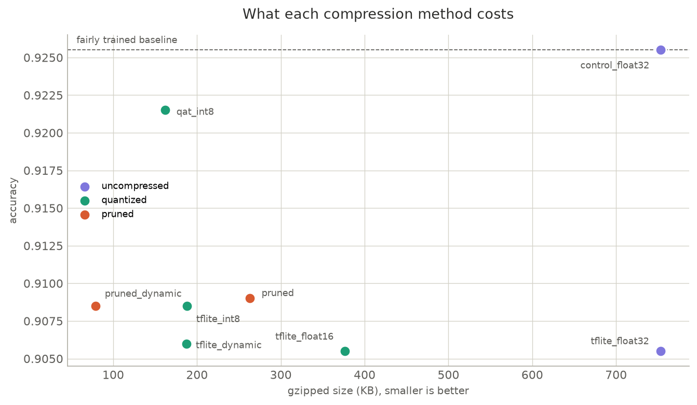

# Model Compression: Quantization and Pruning

IE 7374 MLOps, Lab Assignment 4

Based on the [Quantization and Pruning lab](https://github.com/raminmohammadi/MLOps/tree/main/Labs/Model_Development/Quantization_and_Pruning)
from the course repo, with the changes listed below.

Takes a trained image classifier and makes it smaller and faster seven
different ways, then measures what each one actually costs.

## Results



| Variant | KB | gzipped KB | Accuracy | Latency (ms) |
|---|---|---|---|---|
| tflite_float32 | 812.6 | 753.0 | 0.9055 | 0.045 |
| control_float32 | 812.6 | 753.3 | **0.9255** | 0.045 |
| tflite_float16 | 409.6 | 376.6 | 0.9055 | 0.045 |
| tflite_dynamic | 209.4 | 187.5 | 0.9060 | 0.025 |
| tflite_int8 | 212.0 | 188.1 | 0.9085 | **0.016** |
| qat_int8 | 209.6 | 161.7 | 0.9215 | 0.016 |
| pruned | 812.6 | 263.3 | 0.9090 | 0.046 |
| pruned_dynamic | 209.4 | **79.0** | 0.9085 | 0.027 |

Fashion-MNIST, 2,000 test images for accuracy, median of 300 runs for latency.

## Three things worth pointing out

### Pruning does nothing for the file size

`pruned` is **812.6 KB, exactly the same as the uncompressed model**. Setting a
weight to zero does not make it disappear, it still occupies its four bytes.

The gain only shows up once the file is compressed: 753.0 KB gzipped becomes
263.3 KB, because long runs of zeros compress extremely well. So pruning is
worth it if you ship models over a network or store them compressed, and worth
nothing if you measure the raw file.

This is why the benchmark reports both sizes. Measuring only one of them gives
the wrong answer about pruning.

### The two methods stack

Pruning and quantization work on different things, sparsity and precision, so
combining them multiplies. `pruned_dynamic` is **79.0 KB gzipped against 753.0
for the baseline, 9.5 times smaller**, for 1.7 points of accuracy.

### Compression is not free, and the naive comparison hides that

My first run made quantization look free, with several compressed variants
scoring *higher* than the baseline. That was wrong. QAT and pruning each fine
tune for two extra epochs, so they were being compared against a baseline that
had trained for less time.

`control_float32` fixes it. It is the same uncompressed model given the same
two extra epochs, and it reaches **0.9255**, higher than anything compressed.
Measured against it:

| | Accuracy | Against the control |
|---|---|---|
| control_float32 | 0.9255 | baseline |
| qat_int8 | 0.9215 | −0.4 points |
| pruned | 0.9090 | −1.65 points |
| pruned_dynamic | 0.9085 | −1.7 points |

So quantization-aware training costs almost nothing and pruning costs about
1.7 points. Both are real costs, which the uncontrolled comparison hid.

## What each variant is

| Variant | What was done |
|---|---|
| `tflite_float32` | Converted to TFLite, nothing else. The reference point |
| `control_float32` | Same, but trained the same total epochs as QAT and pruning |
| `tflite_float16` | Weights stored as 16 bit floats |
| `tflite_dynamic` | Weights to int8, activations stay float |
| `tflite_int8` | Weights and activations to int8, needs calibration data |
| `qat_int8` | Trained while simulating int8 rounding, then converted |
| `pruned` | 75% of weights forced to zero during fine tuning |
| `pruned_dynamic` | Pruned, then quantized as well |

## Prerequisites

| Requirement | Version used |
|---|---|
| Python | 3.12 |
| Disk | about 1 GB for TensorFlow |

No GPU and no cloud account. It runs on CPU in a few minutes.

## Setup

```bash
git clone <this-repo-url>
cd mlops-model-compression

python3.12 -m venv .venv
source .venv/bin/activate
pip install -r requirements.txt
```

## Running it

```bash
python -m src.train_baseline --epochs 4
python -m src.compress --epochs 2
python -m src.benchmark --latency-runs 300 --eval-samples 2000
python -m src.report
```

About six minutes on a laptop CPU, most of it the three fine tuning runs.

## What a successful run looks like

```
[baseline] test accuracy 0.9056

[compress] tflite_float32      812.6 KB -> artifacts/tflite_float32.tflite
[compress] tflite_dynamic      209.4 KB -> artifacts/tflite_dynamic.tflite
...
[compress] weights that are zero after pruning: 74.9%

variant                 KB   gzip KB  accuracy      ms
tflite_float32       812.6     753.0    0.9055   0.045
control_float32      812.6     753.3    0.9255   0.045
...
pruned_dynamic       209.4      79.0    0.9085   0.027
```

Afterwards:

- `artifacts/` holds eight `.tflite` files plus the two Keras models
- `evidence/results.json` has every measurement
- `evidence/size-vs-accuracy.png` is the chart above
- pruning sparsity should report close to 75%

Exact numbers will differ slightly on another machine, because training is not
bit reproducible across platforms. The pattern should hold: float16 about half
the size, the int8 variants about a quarter, pruning unchanged raw but far
smaller gzipped.

## Running the tests

```bash
pytest tests -v
```

30 tests. Several check the claims above rather than just the plumbing, for
example that `pruned` is the same raw size as the baseline but less than half
the gzipped size, and that pruning and quantization stack.

## CI

`.github/workflows/ci.yml` has two jobs. One runs the tests against the
committed artifacts and prints the benchmark table. The other trains,
compresses, benchmarks and plots from scratch with reduced settings, to prove
the pipeline runs on a machine that is not mine. It checks that all eight
variants were produced rather than comparing exact numbers, since training is
not reproducible to the decimal across platforms.

## Evidence

| File | What it is |
|---|---|
| `evidence/results.json` | Every measurement for every variant |
| `evidence/run-log.txt` | Terminal output of the benchmark and the tests |
| `evidence/size-vs-accuracy.png` | The chart above |
| `artifacts/*.tflite` | The eight compressed models, committed |

## What I changed from the original lab

The original trains on MNIST, converts to TFLite with one quantization setting,
does QAT, does pruning, and measures the zipped file size.

| Change | What it does |
|---|---|
| **Seven variants instead of one** | float16 and full int8 with a representative dataset were not covered, and pruning and quantization were never combined |
| **A fair control** | The uncompressed model trained for the same total epochs. Without it the comparison makes compression look free |
| **Latency measurement** | The original never times anything. Median of 300 runs per variant, after a warm up |
| **Raw and compressed size** | The original zips the file. Reporting both is what shows pruning does nothing until compressed |
| **A comparison table and chart** | Every variant measured the same way, in one place |
| **Fashion-MNIST instead of MNIST** | MNIST is easy enough that every variant scores about the same, so the tradeoff is invisible |
| **Scripts instead of a notebook** | So it can be tested and run in CI |
| **30 tests** | Including tests of the claims, not just that the code runs |
| **CI** | Tests plus a full end to end smoke run |

## Things that caught me out

**`tensorflow_model_optimization` needs the old Keras.** It predates Keras 3,
which TensorFlow 2.16 and later ship by default, so pruning and QAT fail
without `TF_USE_LEGACY_KERAS=1`. It has to be set before TensorFlow is
imported, which is why it lives in `src/__init__.py` rather than in a script.

**The first comparison flattered compression.** Covered above. The fix was a
control, not a different metric.

**Pruning looked like it had done nothing.** The file size was identical to the
baseline and I assumed `strip_pruning` had failed. The sparsity check said
74.9% of weights were zero, so it had worked, and the file size was simply the
wrong thing to measure.

## Layout

```
src/__init__.py          sets TF_USE_LEGACY_KERAS before TensorFlow loads
src/data.py              Fashion-MNIST and the int8 calibration sample
src/model.py             the baseline network
src/train_baseline.py    step 1, train the uncompressed model
src/compress.py          step 2, build all seven variants
src/benchmark.py         step 3, measure size, accuracy and latency
src/report.py            step 4, draw the chart
tests/test_compression.py
artifacts/               the models, committed
evidence/                results, run log and chart
```

## Limitations

- One architecture only. The tradeoffs differ for larger models, where
  quantization usually costs less proportionally
- Latency is measured on one CPU with XNNPACK. Int8 gains are typically larger
  on mobile hardware with dedicated integer support
- Accuracy uses 2,000 of the 10,000 test images, because TFLite runs one image
  at a time and the full set is slow
- Pruning sparsity is fixed at 75% rather than swept
